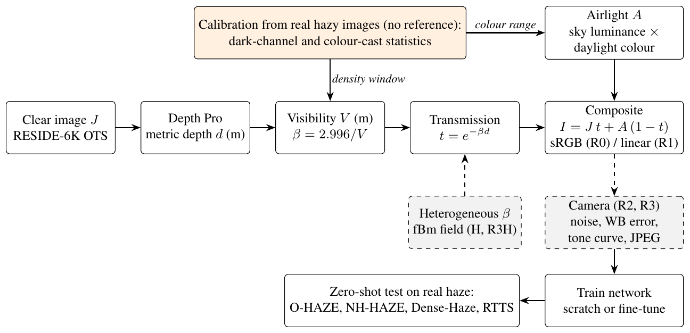

# What Makes Synthetic Haze Transfer to Real Haze? A Controlled Study of Physically Grounded Haze Synthesis

**Team Sharanga**: Hrusikesh Nishank (Department of Computer Science and Engineering) and Akanksha Tiwari (School of Artificial Intelligence and Data Science), Indian Institute of Technology Jodhpur
CSL7360 Computer Vision, course project, November 2026

The report is in [`report/CV_Dehazing_Study_Report.pdf`](report/CV_Dehazing_Study_Report.pdf), and its LaTeX source in [`report/latex/`](report/latex/).

---

## Summary

Dehazing networks are trained on synthetic hazy images and then used on real haze. The standard recipe (RESIDE) applies the atmospheric scattering model with a unit-less depth map, a random scattering coefficient and a grey airlight, directly on gamma-encoded sRGB pixels. This project asks **which parts of hazy-image formation actually matter for real haze**. We change one component at a time and keep everything else fixed: clear images, depth, random draws, network, schedule and seed.

The synthesis pipeline is built on metric depth (Depth Pro). Haze density is expressed as a visibility in metres (β = 2.996 / V), and the airlight is drawn from daylight colours. Each of the following can be switched on separately:

- compositing in linear radiance;
- a camera model (sensor noise after the haze, randomised white balance and tone curve, JPEG);
- spatially varying extinction.

Each variant ("arm") is used to train DehazeFormer-T and gUNet-T from scratch, or to fine-tune the published DehazeFormer-B and DEA-Net checkpoints. Every model is then tested zero-shot on real haze: O-HAZE, NH-HAZE and Dense-Haze for PSNR/SSIM, and RTTS for detection and no-reference quality.



### Main findings (preliminary: 1,000 training images, short schedules)

DehazeFormer-T trained from scratch; B0, R0 and R1 use three seeds. Each cell is the difference to B0 (RESIDE's own hazy images of the same 1,000 scenes) with its 95 % paired bootstrap interval.

| Comparison | O-HAZE PSNR | NH-HAZE PSNR | Dense-Haze PSNR | SSIM (O / NH / Dense) |
|---|---|---|---|---|
| R0 − B0: our haze, calibrated on hazy test inputs | **+1.38** [+0.93, +1.83] | **+1.02** [+0.75, +1.31] | **+1.33** [+0.89, +1.78] | +0.070 / +0.073 / +0.037 |
| R1 − B0: + linear-radiance compositing | **+2.29** [+1.72, +2.87] | **+1.36** [+1.10, +1.63] | **+1.23** [+0.82, +1.64] | — |
| R0_rtts − B0: calibrated on RTTS only | −0.08 [−0.44, +0.28] | +0.19 [−0.02, +0.41] | **+0.45** [+0.02, +0.89] | +0.057 / +0.067 / +0.021 |
| R0_uncal − B0: no calibration | −0.16 | +0.08 | −0.28 | ≈ 0 |
| N0 − B0: grey airlight | **−1.00** | **−0.46** | **−0.71** | — |

- **Realistic haze density helps structure (SSIM) even when calibrated on a different dataset.** Metric depth and visibility make the density controllable. With RTTS-only calibration, about 80 % of the SSIM gain over RESIDE remains.
- **Most of the PSNR gain on these benchmarks comes from matching their airlight colour.** The haze-machine test sets are bluish, and calibrating on their hazy inputs (no ground truth used) captures that. With RTTS-only calibration, the PSNR gain on O-HAZE and NH-HAZE disappears.
- **Linear-radiance compositing helps when training from scratch** (+0.91 / +0.34 dB on O-HAZE / NH-HAZE over R0, three seeds). It does not help with RTTS-only calibration or when fine-tuning.
- **Two components hurt in this setting:** sensor noise added after the haze (−0.81 / −0.34 / −0.49 dB), and our fBm heterogeneous extinction (−1.8 / −0.6 / −2.4 dB).
- **Fine-tuning published models:** DehazeFormer-B fine-tuned on our haze (R3) beats the same model fine-tuned on RESIDE for the same number of steps by +2.36 / +1.24 / +0.97 dB.
- **RTTS detection (YOLOv8m mAP50) stays at 71–72 for every method**, including the raw hazy input. It does not separate the methods.

All numbers come from [`results/quick_report.md`](results/quick_report.md) and the per-run files in [`results/per_run/`](results/per_run/).

---

## Repository layout

```
CV-Dehazing-Study/
├── README.md                  this file
├── requirements.txt           Python packages (install PyTorch first, see Setup)
├── haze/                      the method
│   ├── synth.py               all synthesis arms (B0 is read from disk; N0, R0-R4, R3N, H, R3H, S0, R3M)
│   ├── isp.py                 camera model: unprocessing, noise, white balance, tone curve, JPEG
│   ├── data.py                seeded datasets (all arms share crops, flips and (V, A) draws), test-set loader
│   ├── models.py              one registry for DehazeFormer, gUNet, DEA-Net, FFA-Net, DCP; tiled inference
│   ├── metrics.py             PSNR, SSIM (matches scikit-image), dark-channel statistics
│   └── dcp.py                 Dark Channel Prior baseline
├── prepare_depth.py           Depth Pro metric depth for the clear training images
├── prepare_params.py          per-image visibility V and airlight A draws (calibration ranges as arguments)
├── train.py                   one training run (any model x arm x seed; scratch or fine-tune)
├── eval_paired.py             PSNR / SSIM on O-HAZE, NH-HAZE, Dense-Haze
├── eval_rtts.py               RTTS: YOLOv8m mAP50 + NIQE / BRISQUE / MUSIQ / CLIP-IQA
├── stats.py                   result tables and paired bootstrap intervals
├── quick.py                   the preliminary protocol used for all reported numbers (budgeted to N hours)
├── quick_report.py            builds results/quick_report.md from the per-run results
├── realism.py                 synthetic-vs-real haze statistics (dark channel, colour cast) and KID
├── preflight.py               GPU / data / weights check before long runs
├── make_queues.py             writes the full-protocol queues into queues/
├── run_queue.py               restart-safe sequential job runner (one log per command)
├── make_tables.py, make_figures.py   LaTeX tables and qualitative figures from a results folder
├── setup_third_party.py       downloads the official model code into third_party/
├── queues/                    the extra control runs (q_extra*.txt) and the full protocol (q0-q5)
├── tests/                     unit tests (synthesis invariants, models, metrics)
├── results/                   everything the report is built from (see results/README.md)
└── report/
    ├── CV_Dehazing_Study_Report.pdf
    └── latex/                 main.tex, refs.bib, neurips_2025.sty, figs/, tables/, build_tables.py
```

Not included (too large, or third-party): datasets (`data/`), official checkpoints (`ckpt/`), our trained weights (`runs_quick/`, about 210 MB), dehazed output images, and the third-party model code (`third_party/`, fetched by `setup_third_party.py`).

---

## The synthesis arms

All arms share the same clear images, Depth Pro depth, stored (V, A) draws and random streams.

| Arm | Hazy-image formation |
|---|---|
| B0 | RESIDE-OTS's own hazy images of the same clear images (the standard synthesis) |
| N0 | sRGB ASM, our depth and visibility, **grey** airlight |
| R0 | sRGB ASM, our depth and visibility, daylight-coloured airlight |
| R1 | R0 composited in **linear radiance** |
| R2 | R1 + shot/read noise added after the haze (camera RAW space) |
| R3 | R2 + randomised white balance, tone curve and JPEG ("full camera") |
| R3N | R3 without sensor noise |
| R4 | R3 + forward-scatter blur (implemented, not used in the reported runs) |
| H, R3H | R0 / R3 with spatially varying extinction (fBm field, mean extinction preserved) |
| `_uncal` | V log-uniform in 50 m – 5 km, no density window, daylight 5,000–10,000 K |
| `_rtts` | density window and colour range measured on RTTS only (mean transmission 0.17–0.70, 5,600–7,500 K) |

Default calibration: V log-uniform in 10 m – 5 km, re-drawn until the image's mean transmission is in [0.10, 0.85]; airlight luminance from the far/sky region, colour from the CIE daylight locus at 5,500–9,500 K. These ranges were set from statistics of the hazy inputs of the real test sets and RTTS. No ground truth was used; see Section 5.4 of the report.

---

## Setup

Tested on Windows 11, Python 3.10, PyTorch 2.11 + CUDA 12.8, with one RTX 5060 Ti (16 GB).

```powershell
conda create -n haze python=3.10 -y
conda activate haze
pip install torch torchvision --index-url https://download.pytorch.org/whl/cu128   # any CUDA build that supports your GPU
pip install -r requirements.txt
python setup_third_party.py        # official DehazeFormer, gUNet (+FFA-Net) and DEA-Net code -> third_party/
python tests/test_synth.py         # ends with: ALL SYNTH TESTS PASSED
python tests/test_models.py        # ends with: ALL MODEL TESTS PASSED (checkpoint tests are skipped if ckpt/ is absent)
```

### Data and checkpoints (expected layout)

```
data/reside6k_ots/GT/0001.jpg ...       RESIDE-6K outdoor clear images (3,000)
data/reside6k_ots/hazy/0001.jpg ...     RESIDE-6K outdoor hazy images (arm B0)
data/test/OHAZE/{hazy,GT}/              O-HAZE (45 pairs)
data/test/NHHAZE/NN_hazy.png, NN_GT.png NH-HAZE (55 pairs)
data/test/DENSE/{hazy,GT}/              Dense-Haze (55 pairs)
data/test/RTTS/{JPEGImages,Annotations} RTTS (4,322 images, VOC boxes)
data/sota_outputs/HazeFlow/RTTS/        HazeFlow's published RTTS outputs (optional)
ckpt/outdoor/dehazeformer-{t,s,b,m}.pth official DehazeFormer weights (RESIDE-OTS)
ckpt/deanet/deanet-ots.pth              official DEA-Net weights (OTS)
ckpt/yolov8m.pt                         COCO YOLOv8m (Ultralytics)
```

All datasets and checkpoints come from their authors' official releases. `preflight.py` checks that everything is present and that every model, arm and metric runs on the GPU.

---

## Reproducing the results

```powershell
python preflight.py                                   # about 5 min
python quick.py --hours 8                             # depth, (V, A) draws, speed probes, then 15 trainings + evaluation
python run_queue.py queues/q_extra.txt                # 11 control runs (N0, uncalibrated, RESIDE fine-tune controls, R3N, seeds ...)
python run_queue.py queues/q_extra3.txt               # RTTS-only calibration + third seeds
python quick.py --report_only                         # results_quick/quick_report.md, tables.tex, figures
```

Everything is restart-safe: a finished step is skipped when the command is run again. Each step writes a log under `logs/<queue>/`.

| Step | Time on the RTX 5060 Ti |
|---|---|
| Depth Pro for 3,000 images | 40 min |
| One DehazeFormer-T run (3,500 iterations, batch 16) | about 22 min |
| One gUNet-T run (8,400 iterations) | about 25 min |
| Paired evaluation | 1–2 min per model |
| RTTS evaluation (500 images) | 5–15 min per model |

To rebuild the report tables and the effect-size figure from the stored results:

```powershell
python report/latex/build_tables.py
python quick_report.py --res_dir results/per_run --runs_dir results   # writes quick_report.md and tables.tex into results/per_run/
```

The full protocol (all 3,000 images, long schedules, three seeds for every arm) is prepared in `make_queues.py`. Run `python make_queues.py --iters 40000 --ft_iters 8000`, then `queues/q0_prep.txt` … `q5_arch2.txt`. It was not run for this report.

---

## Evaluation protocol

- **Paired sets:** resized so the long side is 1,024 px (bicubic), full-image inference (tiled only if out of memory), 8-bit outputs, PSNR on RGB in [0, 1], Gaussian SSIM (σ = 1.5).
- **RTTS:** fixed 500-image subset. YOLOv8m (COCO) with conf 0.001 and NMS IoU 0.6; VOC all-point AP at IoU 0.5 on the five RTTS classes, ignoring objects marked difficult. NIQE, BRISQUE, MUSIQ and CLIP-IQA (pyiqa) on 100 images.
- **Statistics:** 95 % paired bootstrap over test images (10,000 resamples) on seed-averaged per-image scores. A difference counts if the interval excludes zero and |Δ| ≥ 0.3 dB (and exceeds twice the seed standard deviation where several seeds exist). These rules were fixed before the runs.
- **One code path:** every row, including the published checkpoints, is evaluated by the same code. No number is copied from a paper.

## Limitations

- **Small and short:** 1,000 training images, short schedules, one to three seeds.
- **One component at a time:** a full factorial design was not run, so interactions between components are not measured.
- **Test sets:** the paired sets use haze-machine haze (155 images in total).
- **Calibration:** the default calibration uses statistics of the test sets' hazy inputs. The RTTS-only controls show how much depends on this.

## Acknowledgements

This project uses the official code and weights of DehazeFormer, gUNet, DEA-Net and FFA-Net (fetched into `third_party/` under their own licenses). It also uses Depth Pro (via Hugging Face Transformers), Ultralytics YOLOv8 and pyiqa, and the RESIDE, O-HAZE, NH-HAZE, Dense-Haze and RTTS datasets. The camera model follows Brooks et al., *Unprocessing Images for Learned Raw Denoising* (CVPR 2019).
